# How the driving network works, and how it was trained

This document explains the whole learning setup built in October 2026: what
the car's numbers are and where they come from, how the training simulator
works (with the math), how the networks were trained (imitation learning and
reinforcement learning with PPO), what they learned, how they were exported,
and how they were tested in Gazebo. It ends with the open problems and how to
reproduce everything.

Related documents: `interfaces.md` (exact module interfaces and the list of
findings F1 to F22), `camera_f200.md` (the camera), `rmw_comparison.md`
(middleware measurements), `orin_ssh_docker.md` (Orin setup).

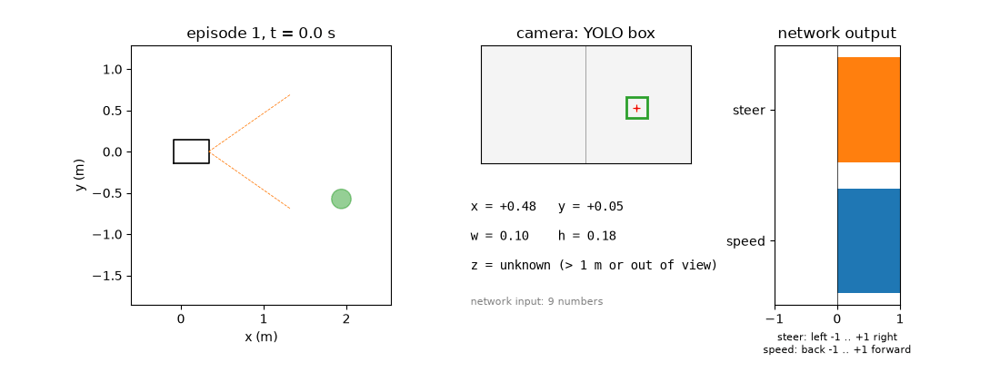

*The trained network (`ppo_search`) in the training simulator. Left: the car
seen from above, with its path and the camera's field of view (orange dashed).
Middle: what the network "sees", only the YOLO box and the depth. Right: the
network's two outputs. In episodes 3 and 4 the ball starts outside the camera
view and the car has to search for it.*

## Contents

1. [The goal and the chain](#1-the-goal-and-the-chain)
2. [The car in numbers](#2-the-car-in-numbers)
3. [The training simulator](#3-the-training-simulator)
4. [The rule based controller](#4-the-rule-based-controller)
5. [Step 3: imitation learning](#5-step-3-imitation-learning)
6. [Step 4: reinforcement learning with PPO](#6-step-4-reinforcement-learning-with-ppo)
7. [Learning to search](#7-learning-to-search)
8. [The network and its export to ONNX](#8-the-network-and-its-export-to-onnx)
   (8.1: [How small can the network be?](#81-how-small-can-the-network-be))
9. [The experiment in Gazebo](#9-the-experiment-in-gazebo)
   (9.3: [The network on the Orin](#93-the-network-on-the-orin),
   9.4: [Commands: Gazebo on the laptop, network on the Orin](#94-commands-gazebo-on-the-laptop-network-on-the-orin),
   9.5: [YOLO on the Orin sees the Gazebo camera](#95-yolo-on-the-orin-sees-the-gazebo-camera))
10. [All results in one place](#10-all-results-in-one-place)
11. [Open problems](#11-open-problems)
12. [Reproduce everything](#12-reproduce-everything)

## 1. The goal and the chain

The car should drive to an object it sees and stop in front of it. On the
robot, the chain is:

```
F200 camera ──images──▶ YOLO ──box──▶ target observation ──9 numbers──▶ policy network ──steer, speed──▶ hub bridge ──Bluetooth──▶ LEGO hub ──▶ motors D, A, B
```

The **policy network** is the part that was trained here. It gets nine
numbers and outputs two:

| Input | Meaning | Output | Meaning |
|---|---|---|---|
| `visible` | 1 if YOLO found the object, else 0 | `steer` | -1 full left … +1 full right |
| `x`, `y` | box center in the image, -1 … +1 | `speed` | -1 full reverse … +1 full forward (fraction of motor power) |
| `w`, `h` | box size as a fraction of the image | | |
| `z_valid`, `z` | depth to the object surface in m, if the F200 has one (0.2 to 1.0 m) | | |
| `prev_steer`, `prev_speed` | its own previous output | | |

Training does not use the real camera or YOLO. A **training simulator**
computes what they would report, from the true positions of car and object.
This is fast (about 15,000 steps per second) and lets the network practice
hundreds of thousands of drives in minutes. The trained network is then tested
in **Gazebo**, a 3D physics simulator, through the same ROS 2 interfaces the
real robot will use.

| Phase | Where | What drives |
|---|---|---|
| Training (steps 2 to 4) | `policy/`, Python, laptop CPU | network inside the training simulator |
| Test in Gazebo (step 5) | `odse_ws/src/odse_driving`, ROS 2 nodes | ONNX file in a ROS 2 node |
| Real car (step 6, not yet) | Orin | ONNX file with TensorRT |

## 2. The car in numbers

Everything the simulators know about the car comes from a few measurements on
the real vehicle.

| Quantity | Value | Source |
|---|---|---|
| Wheelbase $L$ | 0.25 m | measured |
| Track width | 0.18 m | measured |
| Wheel diameter | 0.085 m | measured |
| Length, width, height | 0.42, 0.28, 0.15 m | measured |
| Turning circle at full lock | 1.20 m diameter | measured with `left_circle.py` |
| Time for one circle at 30 % power | 12 s | measured (24 s gave two circles) |
| Steering motor D range | about 222° lock to lock; the scripts use ±89° (80 %) | measured with `find_steering.py` |

### Steering angle from the turning circle

The car steers with the front axle. The standard model for this is the
**bicycle model**: both front wheels are combined into one steered wheel, both
rear wheels into one fixed wheel. The rear axle then moves on a circle around
the point where the two wheel axes meet.

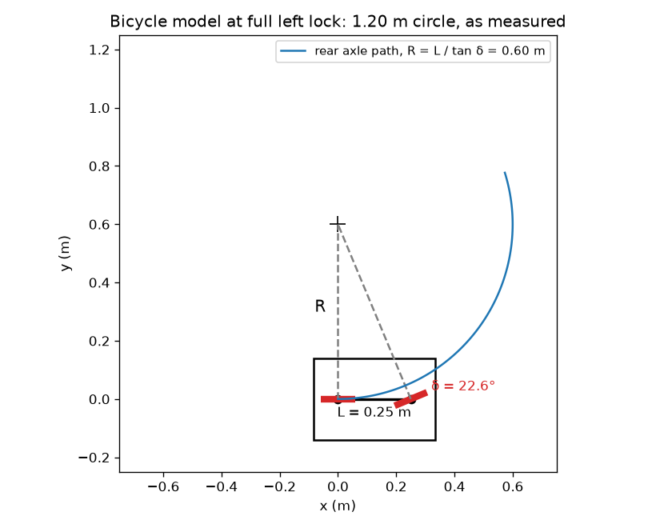

For a wheelbase $L$ and front wheel angle $\delta$ the turning radius of the
rear axle is

$$R = \frac{L}{\tan \delta}.$$

A 1.20 m circle means $R = 0.60$ m, so the full lock angle is

$$\delta_{max} = \arctan \frac{L}{R} = \arctan \frac{0.25}{0.60} = 0.395 \text{ rad} = 22.6°.$$

### Speed from the circle time

At 30 % motor power one circle of circumference $\pi \cdot 1.20 = 3.77$ m took
12 s, so

$$v_{30\%} = \frac{3.77 \text{ m}}{12 \text{ s}} = 0.31 \text{ m/s}.$$

An independent check: in `find_steering.py` the drive motors turned about
400°/s at that power. With 8.5 cm wheels (circumference 0.267 m) that is
$\frac{400}{360} \cdot 0.267 = 0.30$ m/s. Both agree, which also means the
motors drive the wheels at about 1:1.

The simulators assume speed is proportional to power, so 100 % would be about
1 m/s. **Only the 30 % point is measured** (finding F8), which is why training
later limits the speed to 40 %.

## 3. The training simulator

File: `policy/lego_car_env.py`, class `LegoCarEnv`. It follows the
**Gymnasium** interface, the standard for reinforcement learning
environments:

```python
obs, info = env.reset(seed=...)                                # new episode
obs, reward, terminated, truncated, info = env.step(action)    # 0.1 s later
```

Each call to `step` advances time by $\Delta t = 0.1$ s, so the network
decides 10 times per second, as it will on the robot.

### 3.1 State

The simulator keeps the true state of the world:

| Symbol | Meaning |
|---|---|
| $p_x, p_y, \theta$ | car position (rear axle center, `base_link`) and heading |
| $v$ | car speed |
| $\delta$ | actual front wheel angle |
| $o_x, o_y, r$ | object center and radius |

The network never sees this state. It only sees the observation (section 3.4).

### 3.2 Car motion

An action $a = (s, u)$ (steer, speed) is turned into targets:

$$\delta^* = -s \cdot \delta_{max} \cdot k_\delta + \delta_0, \qquad v^* = \operatorname{clip}(u, -0.4, 0.4) \cdot 1.0 \tfrac{\text{m/s}}{} \cdot k_v$$

The minus sign makes $s = +1$ steer right, while angles count positive to the
left (REP-103). $k_\delta$, $k_v$ and $\delta_0$ are random per episode
(section 3.6). The clip is the **speed limit** of 40 % (section 6.5).

The actuators do not jump to their targets. The steering turns at most
$\dot\delta_{max} = 1.5$ rad/s, and the motors follow with a time constant
$\tau = 0.25$ s. Each 0.1 s step is integrated in 5 substeps of
$h = 0.02$ s (Euler method):

$$\delta \leftarrow \delta + \operatorname{clip}(\delta^* - \delta, \; -\dot\delta_{max} h, \; \dot\delta_{max} h)$$

$$v \leftarrow v + \frac{h}{\tau} (v^* - v)$$

$$p_x \leftarrow p_x + v \cos\theta \, h, \qquad p_y \leftarrow p_y + v \sin\theta \, h, \qquad \theta \leftarrow \theta + \frac{v}{L} \tan\delta \, h$$

The last line is the bicycle model again: the yaw rate is
$\dot\theta = v \tan\delta / L = v / R$.

**Delay.** Commands reach the motors $d$ steps late, $d \in \{0, 1, 2\}$
(0 to 0.2 s), random per episode. This stands in for YOLO's processing time
plus the Bluetooth delay to the hub, which is not yet measured (F9).

### 3.3 Camera model

The F200's color camera (on which YOLO runs) sees 70° horizontally and 43°
vertically; the depth camera sees 68° horizontally, from 0.2 to 1.0 m
(`camera_f200.md`). The camera sits 0.25 m in front of the rear axle and
$h_{cam} = 0.15$ m above the floor.

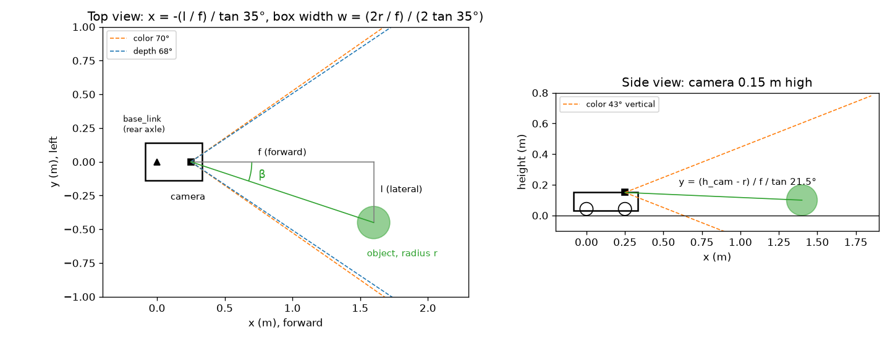

First the object is expressed in the car's frame (forward $o'_x$, left $o'_y$):

$$\begin{pmatrix} o'_x \\ o'_y \end{pmatrix} = \begin{pmatrix} \cos\theta & \sin\theta \\ -\sin\theta & \cos\theta \end{pmatrix} \begin{pmatrix} o_x - p_x \\ o_y - p_y \end{pmatrix}$$

Seen from the camera, the object is $f = o'_x - 0.25$ m ahead and $l = o'_y$
to the left, at bearing $\beta = \operatorname{atan2}(l, f)$.

**Visible** if it is in front ($f > r$), inside the horizontal view
($|\beta| \le 35°$), and its box would be at least 10 pixels high in the
360 pixel high image YOLO works on:

$$\text{box height in pixels} = \frac{2r/f}{2 \tan 21.5°} \cdot 360 \;\ge\; 10.$$

For a 20 cm ball ($r = 0.1$ m) that means $f \le \frac{0.2 \cdot 360}{10 \cdot 2 \tan 21.5°} \approx 9$ m,
so in a room the field of view is the limit, not the size.

**Box position and size.** For a pinhole camera, a point at bearing $\beta$
appears at $\tan\beta / \tan(\text{half view})$ of the half image width from
the center. With image x pointing right (so the sign flips):

$$x = -\frac{l / f}{\tan 35°}, \qquad y = \frac{(h_{cam} - r) / f}{\tan 21.5°}$$

$$w = \frac{2r/f}{2 \tan 35°}, \qquad h = \frac{2r/f}{2 \tan 21.5°}$$

($y$ is positive below the image center.) For a real YOLO box with center
$(u, v)$ in a $W \times H$ image these are exactly $x = 2u/W - 1$,
$y = 2v/H - 1$, $w = \text{box width}/W$, $h = \text{box height}/H$, which is
how the real chain will compute them (`interfaces.md`, M3).

**Depth.** The distance from the camera to the object surface is
$z = f - r$. It is valid only if the object is also inside the depth camera's
68° view and $0.2 \le z \le 1.0$ m.

### 3.4 Fake YOLO: noise and missed detections

A real detector is not perfect, so the simulator adds errors (scaled by a
random factor $n \in [0.5, 1.5]$ per episode):

| Field | Error |
|---|---|
| `visible` | missed detection with probability $p \in [0, 0.15]$ per frame |
| $x$, $y$ | Gaussian noise, standard deviation $0.02 n$ |
| $w$, $h$ | multiplied by $1 + \varepsilon$, $\varepsilon \sim \mathcal{N}(0, (0.05n)^2)$ |
| $z$ | Gaussian noise, standard deviation $0.01 n$ m |

When not visible, all detection fields are 0. The observation vector is then

$$o_t = (\text{visible}, x, y, w, h, z_{valid}, z, s_{t-1}, u_{t-1}) \in \mathbb{R}^9.$$

The previous action is part of it. That gives the network a little memory, for
example "I was steering left", which it uses while searching (section 7).

### 3.5 Reward and episode end

The **gap** $g$ is the distance from the car's front to the object surface.
The goal is $g^* = 0.30$ m. Each step earns

$$r_t = \underbrace{5 \left( |g_{t-1} - g^*| - |g_t - g^*| \right)}_{\text{progress}} \;-\; \underbrace{0.01}_{\text{time}} \;-\; \underbrace{0.02 \, |x_t| \cdot \text{visible}_t}_{\text{keep centered}} \;-\; \underbrace{0.05 \, |s_t - s_{t-1}|}_{\text{smooth steering}} \;+\; R_{end}$$

The progress term pays for every centimeter of approach toward the stop point
and charges for moving away. Summed over an episode it telescopes to
$5 (|g_0 - g^*| - |g_T - g^*|)$, so it rewards the result, not a particular
path. (This kind of term is called potential based reward shaping, with
potential $\Phi = -5 |g - g^*|$.)

| Episode ends with | $R_{end}$ |
|---|---|
| **arrived**: $\lvert g - 0.30\rvert \le 0.15$ m, object in front of the car (laterally within its 28 cm width), speed below 0.05 m/s | +10 |
| **collision**: object overlaps the car's rectangle | -10 |
| **away**: more than 4 m from the object | -5 |
| **lost**: object out of view for 3 s (only in the `ahead` scenario) | -5 |
| **timeout**: 40 s (400 steps) | 0 (truncated) |

### 3.6 Randomization

To keep the network from relying on exact numbers that will differ on the real
car, each episode draws new values (domain randomization):

| Parameter | Range | Stands for |
|---|---|---|
| speed factor $k_v$ | 0.85 to 1.15 | battery charge, floor |
| steering factor $k_\delta$ | 0.9 to 1.1 | steering play |
| steering offset $\delta_0$ | ±0.035 rad (±2°) | calibration error |
| command delay $d$ | 0, 1 or 2 steps | YOLO and Bluetooth delay |
| missed detections $p$, noise $n$ | see 3.4 | detector quality |
| object radius $r$ | 0.06 to 0.15 m | object size |

### 3.7 Scenarios

| Scenario | Object at start |
|---|---|
| `ahead` | inside the camera view, 0.8 to 3.0 m away |
| `anywhere` | any direction around the car, 0.8 to 2.5 m away; must often be searched for |
| `mixed` | half and half |

### 3.8 Why not train in Gazebo?

Gazebo renders the scene and simulates physics. On this laptop it runs at
about 0.27 times real time with cameras, about 3 steps of 0.1 s per second.
The training simulator does about 15,000. A million training steps take 4
minutes here and would take about 4 days in Gazebo.

## 4. The rule based controller

File: `policy/expert.py`. A few lines of rules, written by hand. It is the
benchmark and, for imitation learning, the teacher.

$$s = \operatorname{clip}(2.0 \, x, \; -1, 1)$$

$$u = \begin{cases} \operatorname{clip}(0.8 \, (z - 0.385), \; -0.1, \; 0.35) & z \text{ valid} \\ 0.35 & z \text{ not valid}, w < 0.25 \\ 0.15 & z \text{ not valid}, w \ge 0.25 \end{cases}$$

The steering is proportional to how far the box is off center. The speed is
proportional to the remaining distance once the depth reaches below 1 m;
$0.385 = 0.30 + 0.085$ because the camera sits 8.5 cm behind the car front.

When nothing is visible it **searches**: full lock to one side (the side it
was last steering toward, left otherwise) at 20 % power, which drives a
1.2 m circle and sweeps the camera around the room.

| | Ball ahead | Ball anywhere |
|---|---|---|
| Arrived | 100 % | 91.6 % |
| Median time | 5.4 s | 13.3 s |

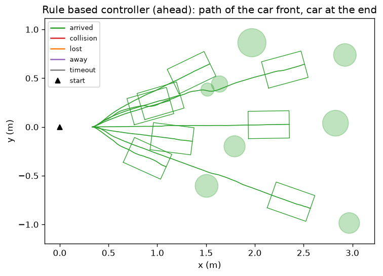

*Paths of the car front (lines) and the car where it stopped (rectangles).
Each car stops about 30 cm in front of its object.*

## 5. Step 3: imitation learning

File: `policy/train_bc.py`. The network $\pi_\theta$ learns to give the same
answers as the rule based controller $\pi^*$.

### 5.1 Behavioral cloning

Collect pairs (observation, teacher's action) and fit the network to them by
minimizing the mean squared error

$$\mathcal{L}(\theta) = \frac{1}{N} \sum_{i=1}^{N} \left\lVert \pi_\theta(o_i) - \pi^*(o_i) \right\rVert^2$$

with the Adam optimizer (learning rate $10^{-3}$, batches of 256, 15 passes
over the data per round).

### 5.2 The problem with plain copying, and DAgger

If the network only sees situations the teacher drove into, its own small
errors take it into situations it has never seen, where it makes bigger
errors. **DAgger** (dataset aggregation) fixes this: let the network drive,
and ask the teacher what it would have done.

```
round 0: teacher drives (with action noise σ = 0.15); record (o, π*(o))
round i = 1 … 6:
    each step: teacher drives with probability βᵢ = 0.5ⁱ, otherwise the network
    record (o, π*(o)) for every step, whoever drove
    add to the dataset, retrain the network on everything
```

After 7 rounds: 38,690 pairs, mean squared error about 0.0000, training time
about 12 s.

### 5.3 Result

On 500 unseen episodes with the ball ahead, the network matches its teacher:

| | Arrived | Median time |
|---|---|---|
| Rule based controller | 100 % | 5.5 s |
| Imitation network | 100 % | 5.5 s |

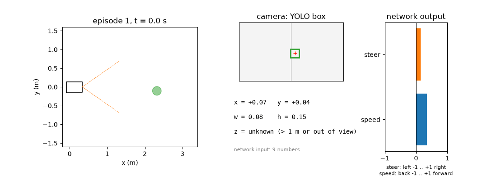

The limit of imitation is visible in the search scenario: the imitation
network was trained before the teacher learned to search, so with the ball
anywhere it arrives in only 31 %. **A copy can never be better than its
teacher.** That is what reinforcement learning is for.

## 6. Step 4: reinforcement learning with PPO

Files: `policy/train_ppo.py`, library Stable-Baselines3. No teacher: the
network starts random and learns only from the rewards of section 3.5.

### 6.1 The idea

The policy is now **stochastic**: given an observation it outputs a Gaussian
distribution over actions,

$$a_t \sim \mathcal{N}\!\left(\mu_\theta(o_t), \, \operatorname{diag}(\sigma^2)\right)$$

where $\mu_\theta$ is the network (the "actor") and $\log\sigma$ is a learned
parameter vector, starting at $\sigma = 1$. The randomness is the exploration:
the car tries slightly different actions and finds out which ones lead to more
reward.

The goal is to maximize the expected discounted return

$$J(\theta) = \mathbb{E}\left[ \sum_{t \ge 0} \gamma^t r_t \right], \qquad \gamma = 0.99.$$

With $\gamma = 0.99$, rewards about $1/(1-\gamma) = 100$ steps (10 s) ahead
still count.

### 6.2 The critic and advantages

A second network, the **critic** $V_\phi(o)$, learns to predict the return
from an observation. It answers "how good is this situation?" From it, PPO
computes how much better an action turned out than expected, the
**advantage**, using generalized advantage estimation (GAE, $\lambda = 0.95$):

$$\delta_t = r_t + \gamma V_\phi(o_{t+1}) - V_\phi(o_t)$$

$$\hat{A}_t = \sum_{l \ge 0} (\gamma\lambda)^l \, \delta_{t+l}$$

$\hat{A}_t > 0$ means the action was better than average in that situation:
make it more likely. $\hat{A}_t < 0$: less likely.

### 6.3 The PPO update

Pushing too hard on noisy advantage estimates ruins a policy, so PPO limits
how far one update can move it. With the probability ratio between the new and
the old policy

$$\rho_t(\theta) = \frac{\pi_\theta(a_t \mid o_t)}{\pi_{\theta_{old}}(a_t \mid o_t)}$$

it maximizes the clipped objective ($\varepsilon = 0.2$)

$$L^{CLIP}(\theta) = \mathbb{E}_t \left[ \min\!\left( \rho_t \hat{A}_t, \; \operatorname{clip}(\rho_t, 1-\varepsilon, 1+\varepsilon) \, \hat{A}_t \right) \right].$$

Once an action's probability has changed by more than 20 %, the objective
stops rewarding further change. The critic is trained at the same time on the
squared error to the observed returns $\hat{R}_t = \hat{A}_t + V_{\phi_{old}}(o_t)$:

$$\mathcal{L}(\theta, \phi) = -L^{CLIP}(\theta) + 0.5 \, \mathbb{E}_t\left[ \left(V_\phi(o_t) - \hat{R}_t\right)^2 \right].$$

### 6.4 The training loop

| Setting | Value |
|---|---|
| Simulators in parallel | 8 |
| Steps collected per update | 8 × 1024 = 8192 |
| Passes over each batch | 10, in minibatches of 256 (320 gradient steps per update) |
| Optimizer | Adam, learning rate $3 \cdot 10^{-4}$, gradient norm clipped at 0.5 |
| Actor and critic | separate networks, 9 → 64 → 64, tanh |
| Advantages | normalized per minibatch |
| Progress check | every 50,000 or 100,000 steps: 100 fixed test episodes without exploration; the best version is kept |

About 4,000 to 4,500 steps per second on the laptop CPU, including learning.

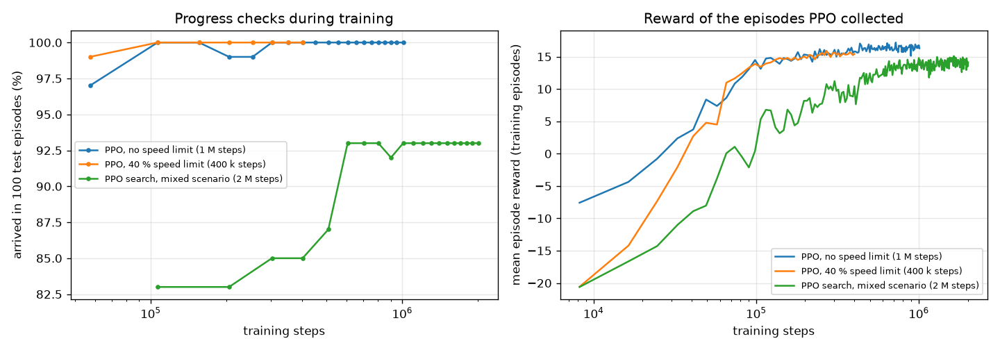

*Left: arrival rate in the progress checks. Right: mean reward of the
episodes PPO collected while exploring. The two ball ahead runs reach 97 to
99 % after 50,000 steps (11 s of training) and 100 % after 100,000. The search
run (green) has a harder task and settles at 93 %.*

### 6.5 Reward hacking: the speed limit

The first PPO network (no speed limit) arrived in 99.6 % of the episodes in a
median 2.6 s, against 5.5 s for the rule based controller. The reason:

| | Speed command median / max | Car speed max | Steering change per step |
|---|---|---|---|
| Rule based | 0.35 / 0.35 | 0.40 m/s | 0.054 |
| Imitation | 0.35 / 0.39 | 0.41 m/s | 0.054 |
| PPO, no limit | 0.60 / 1.00 | **1.14 m/s** | 0.156 |
| PPO, 40 % limit | 1.00 (clipped to 0.40) | 0.46 m/s | 0.103 |

It simply drove at 100 % power. The reward only says "get there", and nothing
forbade it. But speeds above 30 % are an untested extrapolation, the F200 sees
depth only up to 1 m (a second at that speed), and the steering got three
times as jerky. This is typical for reinforcement learning: the network
optimizes exactly what the reward measures, including the simulator's
weaknesses.

The fix: speed clipped to ±0.4 inside the simulator, and five times the cost
for steering changes. The network now always asks for full speed and relies on
the clip, so **the same clip must apply on the robot** (policy node and hub
bridge, `interfaces.md` M4 and M5b).

| | Arrived | Median time |
|---|---|---|
| Rule based | 100 % | 5.5 s |
| PPO, no limit | 99.6 % | 2.6 s |
| **PPO, 40 % limit** | **100 %** | **4.3 s** |

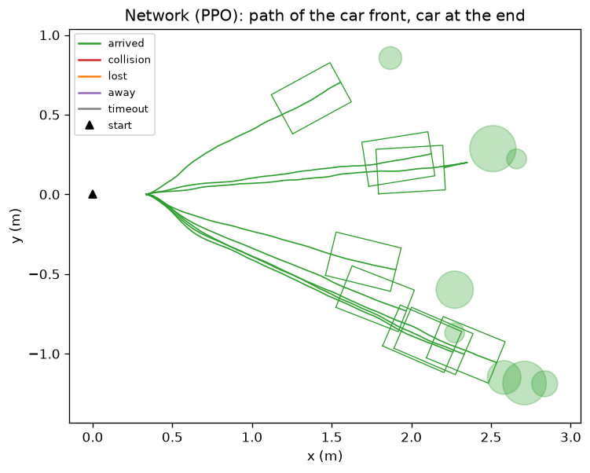

## 7. Learning to search

The networks so far only knew balls that start in view: placed behind the
car, the PPO network just drove straight ahead (F20). So a third network,
`ppo_search`, was trained on the `mixed` scenario (2 million steps, 8 minutes):
half the episodes with the ball ahead, half with it anywhere around the car,
and no "lost" ending, so searching can pay off.

The progress reward also counts while the ball is invisible. A search that
brings the car closer is rewarded even before the ball is seen.

### 7.1 What it learned

Nobody programmed a search. The network found this one:

1. **Nothing visible:** right lock and **reverse** at full allowed speed.
   Backing up with the wheels turned right swings the nose to the left, so the
   camera sweeps across the room.
2. **Ball appears:** switch to forward, steer toward it, brake with the depth,
   stop.

In the animation at the top, episode 3 (ball at 105°, behind on the left)
shows it: at 0.4 s nothing is seen, steer +0.8 and speed -1; at 2.4 s the ball
appears at the left edge ($x = -0.61$) and it steers left and drives forward;
at 4.4 s the ball is centered at 0.95 m.

### 7.2 Results with the ball anywhere

500 unseen episodes:

| | Arrived | Collision | Timeout | Median time |
|---|---|---|---|---|
| Rule based (forward circle search) | 91.6 % | 4.2 % | 4.2 % | 13.3 s |
| Imitation (never learned to search) | 31.0 % | 2.0 % | 54.4 % (and 12.6 % away) | 6.4 s |
| **`ppo_search`** | **87.4 %** | **11.4 %** | 1.2 % | **5.4 s** |

With the ball ahead it still arrives in 100 % (median 4.3 s).

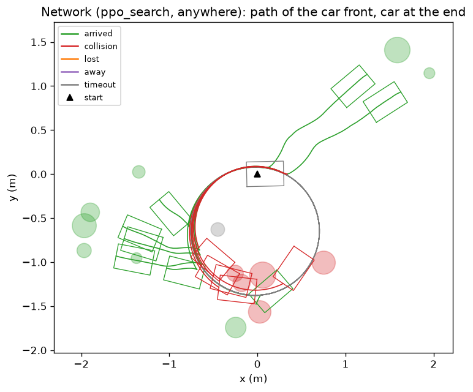

*Successful episodes (green) leave the search circle as soon as the ball
appears. The failures follow from the strategy: red, the ball lies on the
reverse circle and the car backs into it, because the camera looks forward;
gray, the ball lies inside the circle and is never in view.*

So the network finds the ball 2.5 times faster than the hand written search,
but with more collisions, all from reversing blind (F21).

## 8. The network and its export to ONNX

All three networks have the same actor:

$$\mu_\theta(o) = \tanh\!\big(W_3 \tanh(W_2 \tanh(W_1 o + b_1) + b_2) + b_3\big)$$

| Layer | Shape | Parameters |
|---|---|---|
| $W_1, b_1$ | 9 → 64 | 640 |
| $W_2, b_2$ | 64 → 64 | 4,160 |
| $W_3, b_3$ | 64 → 2 | 130 |
| **Total** | | **4,930** |

(For PPO the last layer is linear and the output is clipped to -1 … 1 instead
of squashed by tanh; the Gaussian $\sigma$ is dropped after training, because
the robot uses the mean action $\mu_\theta(o)$, without exploration.)

One evaluation is $9 \cdot 64 + 64 \cdot 64 + 64 \cdot 2 = 4{,}800$ multiply
additions plus 130 tanh, well under a millisecond even on a CPU.

**Export.** PyTorch writes an ONNX file (about 21 KB): input `obs`,
`float32[N, 9]`; output `action`, `float32[N, 2]`. Then 1000 random inputs are
run through both PyTorch and ONNX Runtime and compared. The largest difference
was $3 \cdot 10^{-7}$ to $5 \cdot 10^{-7}$ for every export, which is float32
rounding. The ONNX file is what the ROS 2 node loads now, and what TensorRT
will compile on the Orin.

### 8.1 How small can the network be?

Two layers of 64 looked like far more than 9 inputs and 2 outputs need, so
all three experiments were trained again with seven actor sizes, from
64 × 64 down to a single layer of 4 (`sweep_network_size.sh`). PPO was trained
with three seeds per size, imitation with one (it is deterministic enough that
seeds barely matter). Only the actor shrinks: the PPO critic stays 64 × 64,
because it only runs during training and costs nothing on the Orin, and a good
critic gives the small actor good advantage estimates (section 6.2). Each run
was evaluated on the same 500 unseen episodes as before.

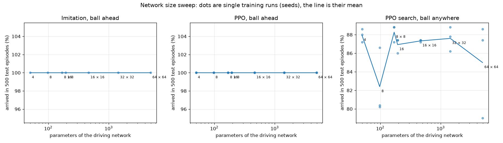

*Arrival rate against the number of actor parameters (log scale). Dots are
single training runs, the line is the mean over seeds.*

| Network | Parameters | Imitation, ahead | PPO, ahead | PPO search, anywhere (mean, min to max) | Search collisions | Search median time |
|---|---|---|---|---|---|---|
| 64 × 64 | 4,930 | 100 % | 100 % | 85.0 % (79.0 to 88.6) | 12.0 % | 5.5 s |
| 32 × 32 | 1,442 | 100 % | 100 % | 87.6 % (86.2 to 88.8) | 10.9 % | 5.5 s |
| 16 × 16 | 466 | 100 % | 100 % | 87.3 % (87.2 to 87.4) | 11.5 % | 5.5 s |
| 16 | 194 | 100 % | 100 % | 86.9 % (86.0 to 87.4) | 11.7 % | 5.9 s |
| 8 × 8 | 170 | 100 % | 100 % | 88.3 % (87.2 to 88.8) | 10.0 % | 5.5 s |
| 8 | 98 | 100 % | 100 % | 82.4 % (80.2 to 86.6) | 7.5 % | 7.7 s |
| **4** | **50** | **100 %** | **100 %** | **87.9 % (87.2 to 88.6)** | **9.5 %** | **5.8 s** |

What this shows:

- **With the ball ahead, size does not matter at all.** Every network, down to
  4 hidden units, arrives in 100 % of the episodes, in 5.5 s (imitation) and
  4.3 to 4.4 s (PPO). Driving toward a visible ball is close to a linear
  mapping: steer by the box's $x$, slow down as the depth shrinks.
- **Searching does not need a big network either.** All sizes reach 86 % to
  88 %, the same as the original `ppo_search` (87.4 %). The differences between
  sizes are about as large as the differences between seeds of one size; the
  worst single run is actually a 64 × 64 one (79.0 %, 15.4 % collisions).
- **The one outlier, a single layer of 8,** is not worse at driving but found
  a different search: two of its three seeds drive forward out of the arena
  in 14 % of the episodes ("away") instead of circling, which lowers both the
  arrival rate and the collisions. The 4 unit network did not do this in any
  seed, so it is a local optimum PPO sometimes falls into, not a capacity
  limit.
- **The 4 unit network has 50 parameters** ($9 \cdot 4 + 4$ in the hidden
  layer, $4 \cdot 2 + 2$ in the output), 1 % of the original. Its ONNX file
  is 1.2 KB, and one evaluation is 44 multiply additions plus 6 tanh.

So the original 4,930 parameters were indeed overkill: for this task, with
these 9 inputs, a single hidden layer of 4 to 16 units is enough. The limit on
the search result is the strategy (reversing blind, F21), not the network size.

Two cautions. The training times in the result files (14 to 29 min per search
run) are not comparable to section 7, because ten runs shared the CPU. And a
larger network may still pay off once the inputs get richer (real YOLO noise,
the IMU, obstacles), so the size should be checked again then.

The original 64 × 64 results are unchanged; the sweep wrote new files
(`bc_h<size>_*`, `ppo_h<size>_s<seed>_*`, `search_h<size>_s<seed>_*`), and a
copy of the earlier `out/` is in `out/backup_h64/`.

## 9. The experiment in Gazebo

Package: `odse_ws/src/odse_driving`. The ONNX network drives the Gazebo car,
through the interfaces of `interfaces.md`:

```
Gazebo ──/ground_truth/odom (car), /world_poses (ball)──▶ sim_target ──/target──▶ policy ──/drive/command──▶ sim_adapter ──/cmd_vel──▶ Gazebo car
                                                                                         └──────────────▶ episode_monitor (outcome, CSV)
```

| Node | Does |
|---|---|
| `sim_target` | stand in for camera and YOLO: true poses from Gazebo, same formulas as section 3.3 (`camera_model.py`), publishes `odse_interfaces/TargetObservation` at 30 Hz |
| `policy` | every 0.1 s (simulated time): builds the 9 numbers, runs the ONNX file, clips speed to 0.4, publishes `ackermann_msgs/AckermannDriveStamped` with steering angle $-s \cdot 0.395$ rad and speed in m/s |
| `sim_adapter` | Gazebo's car plugin wants a speed and a yaw rate, so $\omega = v \tan\delta / L$ |
| `episode_monitor` | applies the arrival and collision rules of section 3.5, logs to `~/odse_experiments/*.csv` |

`policy/compare_gazebo.py` replays the same scenario in the training simulator
(without randomization) and plots both.

### 9.1 Ball ahead

| Network | Training simulator | Gazebo |
|---|---|---|
| PPO (40 % limit) | arrived after 3.2 s, gap 0.31 m | arrived after 2.9 s, gap 0.33 m |
| Imitation | arrived after 4.3 s, gap 0.34 m | arrived after 4.3 s, gap 0.36 m |

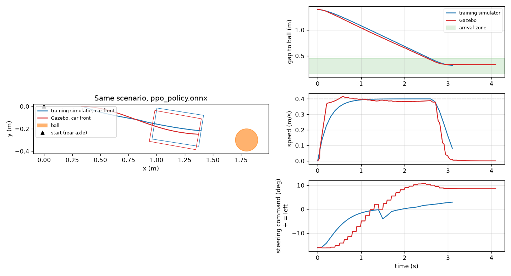

*Blue: training simulator, red: Gazebo, same network and ball position. Gazebo's
car accelerates and brakes harder (its plugin only limits acceleration to
2 m/s²; the training simulator has a 0.25 s motor lag), and it turns more
slowly for the same steering command, so the network keeps steering right
longer and then overshoots to the left (F19).*

### 9.2 Ball behind the car

`ppo_search` in the empty arena, ball at (-0.5, 1.5), behind on the left:

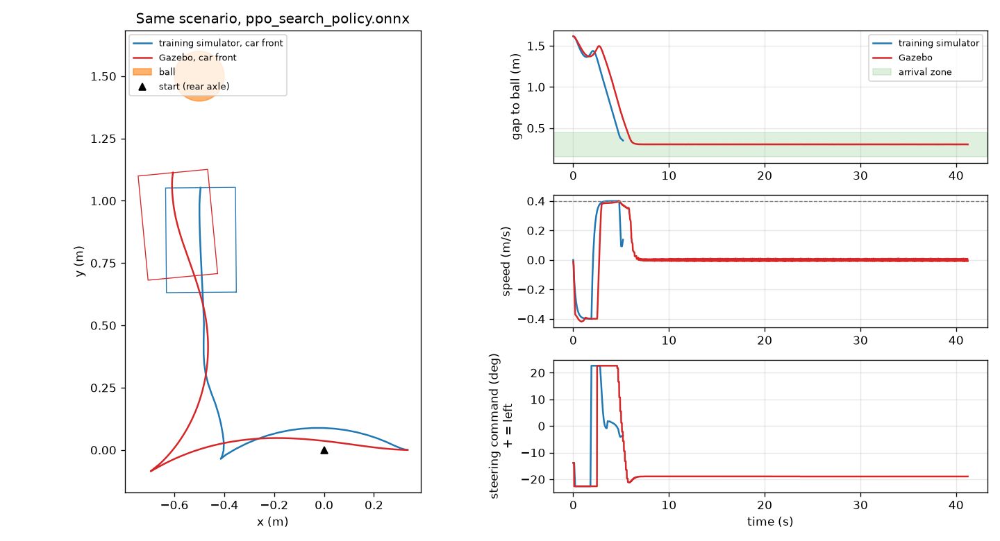

Both simulators show the same strategy: reverse with right lock, ball appears
after about 2 s, forward and left, stop. Gazebo reverses about 0.8 s longer,
approaches at an angle and stops 0.30 m from the ball after 6.4 s, but 15 cm to
the side, so the monitor counts no arrival. It then wants to steer right while
barely moving, and Gazebo's car can only steer while moving (F14, F22); the
training simulator lets it creep forward and correct, and arrives after 5.3 s.

### 9.3 The network on the Orin

First step toward the robot: the same experiment, but the policy node runs on
the Jetson Orin, in its `ros2_lyrical` container, while Gazebo and the other
nodes stay on the laptop. `/target` goes to the Orin and `/drive/command`
comes back over the Ethernet link with Zenoh; the Orin follows Gazebo's
`/clock`. All commands to run it: section 9.4.

| | Laptop | Orin |
|---|---|---|
| `ppo`, ball ahead | arrived after 2.9 s, gap 0.33 m | arrived after 2.9 s and 3.0 s, gaps 0.33 and 0.34 m |
| `ppo_search_h4`, ball at (-0.5, 1.5) | collision after 5.6 s | collision after 5.6 s, same positions every second |
| Network (ONNX Runtime, CPU) | | 0.2 ms median |
| Command, Orin to laptop | | 2 ms median, rare spikes to about 0.1 s |

Moving the network to the Orin changes nothing: same paths, same outcomes.
The link adds 2 ms to a control period of 100 ms. The collision of the 4 unit
search network is its blind reversing (F21): this ball lies on its reverse
circle. The 64 × 64 `ppo_search` found the same ball (section 9.2), so the
two networks search on slightly different circles; in the training simulator
both collide in about 10 % of the episodes (section 8.1).

### 9.4 Commands: Gazebo on the laptop, network on the Orin

Everything needed to run section 9.3, in order. Three places are involved,
each with its own shell:

| Shell | Where | Used for |
|---|---|---|
| PowerShell | laptop, Windows | SSH to the Orin (the key is only on Windows), `orin_policy_windows.py` |
| WSL (`Ubuntu-26.04`) | laptop | Gazebo, `sim_target`, `sim_adapter`, `episode_monitor` |
| `ros2_lyrical` container | Orin | the policy node |

The repository is at `C:\Users\fisch\MyGit\ObjectDetectionAndStateEstimation`
in Windows and `/mnt/c/Users/fisch/MyGit/ObjectDetectionAndStateEstimation` in
WSL. PowerShell commands below run in the repository folder.

#### Once: setup

Skip the steps that are already done. Connecting the Orin (Ethernet,
addresses, SSH key) is in `orin_ssh_docker.md`.

1. **Orin container** with `onnxruntime` and `ackermann_msgs` (PowerShell).
   This recreates the container; anything installed in it by hand is lost,
   `~/ros2_ws` stays.

   ```powershell
   scp docker\Dockerfile docker\entrypoint.sh docker\run_orin.sh fish@192.168.56.1:odse_docker/
   ssh fish@192.168.56.1 "cd ~/odse_docker && bash run_orin.sh"
   ```

   It ends with `Zenoh router running`. Takes a few minutes the first time.

2. **Zenoh router in WSL**, connecting to the Orin (WSL):

   ```bash
   bash /mnt/c/Users/fisch/MyGit/ObjectDetectionAndStateEstimation/scripts/wsl/setup_zenoh.sh
   ```

3. **ROS 2 Python environment and build in WSL** (WSL):

   ```bash
   bash /mnt/c/Users/fisch/MyGit/ObjectDetectionAndStateEstimation/scripts/setup_wsl_ros_python.sh
   cd /mnt/c/Users/fisch/MyGit/ObjectDetectionAndStateEstimation/odse_ws
   source /opt/ros/lyrical/setup.bash
   colcon build
   ```

4. **Copy and build the driving packages on the Orin** (PowerShell):

   ```powershell
   python scripts\orin_policy_windows.py deploy
   ```

   Copies `odse_interfaces` and `odse_driving` (code and ONNX models) to
   `~/ros2_ws/src` on the Orin and builds them in the container. It ends with
   `Summary: 2 packages finished`.

#### Every session: check the connection

PowerShell:

```powershell
ssh fish@192.168.56.1 "docker start ros2_lyrical && docker exec ros2_lyrical pgrep -af rmw_zenohd"
```

It prints the container name and a line with `rmw_zenohd` (the Orin's
router). In WSL:

```bash
systemctl --user is-active zenohd      # active: the laptop's router
ping -c 2 192.168.56.1                 # the Orin answers
```

#### Run an experiment

**Terminal 1, PowerShell: start the network on the Orin** and leave it
running:

```powershell
python scripts\orin_policy_windows.py run --model ppo
```

It prints `model .../ppo_policy.onnx, 10.0 Hz, speed limit 0.4`, after a few
hundred harmless `Schema error` lines from Ubuntu's onnxruntime package. Then
it waits for Gazebo's clock; nothing more happens until step 2.

| `--model` | Network |
|---|---|
| `ppo` | PPO, 64 × 64, ball ahead (default) |
| `ppo_search` | PPO, 64 × 64, also searches when the ball is out of view |
| `bc` | imitation learning, 64 × 64 |
| `ppo_h4` | PPO, 4 hidden units, ball ahead |
| `ppo_search_h4` | PPO, 4 hidden units, with search |

`--start-delay 5` (default) waits 5 simulated seconds before driving.

**Terminal 2, WSL: start Gazebo and the laptop nodes:**

```bash
source /mnt/c/Users/fisch/MyGit/ObjectDetectionAndStateEstimation/odse_ws/install/setup.bash
ros2 launch odse_driving experiment.launch.py policy:=orin
```

Gazebo opens with the car at the origin and the ball 1.8 m ahead. After 5 s
of simulated time the car drives, and the WSL terminal ends with
`OUTCOME: ARRIVED ...` (or `COLLISION`, `TIMEOUT`). A CSV log is written to
`~/odse_experiments/`.

Other scenarios, all with `policy:=orin`:

```bash
# ball behind the car, empty arena; needs --model ppo_search or ppo_search_h4 on the Orin
ros2 launch odse_driving experiment.launch.py policy:=orin world:=arena target_x:=-0.5 target_y:=1.5

# without the Gazebo window (faster)
ros2 launch odse_driving experiment.launch.py policy:=orin gui:=false

# detections with training level noise and 10 % missed frames
ros2 launch odse_driving experiment.launch.py policy:=orin noise:=1.0 dropout:=0.1
```

`policy:=orin` only means that no policy node starts on the laptop. If none
runs on the Orin either, the car simply stands still.

**What to watch:**

| Terminal | Line | Meaning |
|---|---|---|
| Orin | `visible 1 x +0.12 z 0.79 \| steer +0.32 speed 0.40` | once per simulated second: what the network sees and does |
| Orin | `target age 33 ms median ... \| network 0.20 ms median ...` | every 5 s: age of `/target` when used, inference time |
| WSL | `t 1.0 s \| gap to target 1.03 m \| speed 0.40 m/s ...` | once per simulated second: the car in Gazebo |
| WSL | `command age 2 ms median, 3 ms max` | every 50 commands: delay of `/drive/command` from the Orin |
| WSL | `OUTCOME: ...` | result of the episode |

#### Next run, other model

- **Same model, other scenario:** Ctrl+C in terminal 2 and launch again.
  The Orin node keeps running; it sees Gazebo's time jump back and logs
  `simulated time jumped back, new episode`.
- **Other model:** Ctrl+C in terminal 1, then `run --model <name>` again.
- **Compare with the training simulator** (WSL, the latest run):

  ```bash
  source ~/.venvs/odse_policy/bin/activate
  cd /mnt/c/Users/fisch/MyGit/ObjectDetectionAndStateEstimation/policy
  python compare_gazebo.py $(ls -t ~/odse_experiments/*.csv | head -1) --model out/ppo_policy.onnx
  ```

- **Same experiment with the network on the laptop**, for comparison: leave
  out `policy:=orin` and give the model in WSL instead, for example
  `ros2 launch odse_driving experiment.launch.py model:=ppo_search_h4`.
  Stop the Orin node first, or both drive the car at once.

#### Stop

Ctrl+C in both terminals. If the Orin node is still running (for example
after a lost SSH connection), in PowerShell:

```powershell
python scripts\orin_policy_windows.py stop
```

Switching the Orin off: `ssh -t fish@192.168.56.1 "sudo shutdown now"`.

#### After changing code or models

```bash
# WSL: new models from training, then rebuild the laptop side
cd /mnt/c/Users/fisch/MyGit/ObjectDetectionAndStateEstimation/odse_ws
cp ../policy/out/ppo_policy.onnx src/odse_driving/models/      # the files that changed
colcon build --packages-select odse_interfaces odse_driving
```

```powershell
# PowerShell: the Orin side
python scripts\orin_policy_windows.py deploy
```

#### Without the script

What `orin_policy_windows.py run` does, by hand (PowerShell), for example to
look around in the container first:

```powershell
ssh -t fish@192.168.56.1 "docker exec -it ros2_lyrical bash"
```

```bash
# in the container
cd /root/ros2_ws && source install/setup.bash
ros2 launch odse_driving policy.launch.py model:=ppo start_delay:=5
```

#### Checks when nothing moves

In the container on the Orin, while Gazebo runs:

```bash
ros2 topic hz /clock                                                   # Gazebo's clock arrives
ros2 topic echo /target odse_interfaces/msg/TargetObservation --once    # target from the laptop
```

In WSL:

```bash
ros2 topic echo /drive/command ackermann_msgs/msg/AckermannDriveStamped --once   # commands from the Orin
```

Always give the message type to `ros2 topic echo`; without it, the command
may give up before the two sides have found each other.

| Problem | Fix |
|---|---|
| Car stands still, Orin terminal shows only the `model ...` line | No `/clock` on the Orin: check both Zenoh routers (above) and that `RMW_IMPLEMENTATION` is `rmw_zenoh_cpp` in WSL (`echo $RMW_IMPLEMENTATION`) |
| `Package 'odse_driving' not found` on the Orin | run `deploy` again |
| `No module named onnxruntime` on the Orin | old container; redo setup step 1 |
| Car drives oddly, twice the commands | a policy node runs on both sides: `policy:=orin` missing in WSL, or a laptop run while the Orin node is up |
| Orin node from an earlier session still running | `python scripts\orin_policy_windows.py stop` |
| SSH fails | `orin_ssh_docker.md`, Troubleshooting |

### 9.5 YOLO on the Orin sees the Gazebo camera

Stage 2 toward the robot: `sim_target` is switched off. Gazebo renders the
car's color and depth cameras on the laptop, and the Orin runs the real chain
of `interfaces.md`, M2 to M4:

```
Laptop: Gazebo cameras ──images (Ethernet, Zenoh)──▶ Orin: yolo ──/detections──▶ target ──/target──▶ policy
Laptop: sim_adapter → Gazebo car   ◀──────────────────/drive/command──────────────────────────────────┘
```

| Node | Does |
|---|---|
| `yolo` | YOLOv8n as ONNX (`models/yolov8n_384x640.onnx`), ONNX Runtime on the Orin's CPU. Pre and post processing in plain numpy and OpenCV (`yolo.py`); on test frames it gives exactly the boxes of ultralytics. Confidence threshold 0.25 |
| `target` | picks the `sports ball` box with the highest score, normalizes it, reads the depth in the central 20 % of the box; when YOLO loses the ball up close, holds it with the depth camera (below) |

**Does YOLO see the Gazebo ball?** The car was placed at 63 poses around the
plain orange ball (0.35 to 4 m, bearings ±30°) and YOLO ran on each frame:

| Distance, camera to ball | Found (score at least 0.25), 384 × 640 | Same with a 192 × 320 input |
|---|---|---|
| 0.35 to 0.6 m | 21 % | 7 % |
| 0.6 to 1.2 m | 50 % | 86 % |
| 1.2 to 2.2 m | 100 % | 36 % |
| 2.2 to 4 m | 81 % | 14 % |
| all | 65 % | 33 % |

Where YOLO finds the ball, its box agrees with the training camera model
(section 3.3) to 0.02 in x and y and about 8 % in size: the fake YOLO of
training puts the boxes in the right place. What training did not model is
**when** YOLO misses. A soccer ball texture did worse (33 %), and the larger
YOLOv8s did not help below 0.6 m either: up close the ball fills the image and
is cut off at the bottom, and a COCO detector no longer calls it a ball.

That matters because the car stops with the ball about 0.49 m from the
camera. The first runs approached well and then hit the ball: YOLO lost it in
the last half meter, and `visible = 0` makes the network drive on (F23).

**Depth hold.** If the ball had a valid depth (closer than 1 m) in the last
second and YOLO misses it now, the target node measures the depth again where
the box was. If it changed by less than 0.15 m, the ball is reported as still
visible, with the box scaled to the new distance and score 0. Each reading
renews the hold, so a stopped car keeps seeing the ball.

| Run (`ppo`, ball at 1.8, -0.3, room) | Result |
|---|---|
| `sim_target` (section 9.3, for comparison) | arrived after 2.9 s, gap 0.33 m |
| YOLO, no depth hold (2 runs) | collision after 3.8 s and 3.9 s: ball lost at the end |
| YOLO with depth hold (2 runs) | **arrived after 2.9 s, gap 0.33 m**, both times |

With the hold, the run matches `sim_target`. In the last second YOLO reported
nothing, the hold kept the ball at z = 0.43 m, and the network braked to 0.02.

Not yet tested with the depth hold (the runs were stopped when the laptop ran
low on memory): the ball off to the side (arena, 1.5, 0.6) and the search
scenario (`ppo_search`, arena, -0.5, 1.5). Before the hold covered the whole
depth range, the search run found the ball, lost it at 0.83 m and drove off.
A first try with the ball at (1.5, 0.6) in the room failed for another reason:
the red box hides the ball from the start position.

**Timing.** YOLO takes 87 ms on the idle Orin and about 120 ms with the chain
running, so about 6 frames per second of wall time, below the 10 Hz of the
spec (F25). In Gazebo it is enough, because the rendered cameras slow the
simulation to about 0.2 of real time: YOLO handles every camera frame, and an
image is 10 to 15 ms old (simulated time) when its detections go out. For the
real car this needs TensorRT.

**Zenoh.** After runs that were stopped hard, images stopped reaching the
Orin while `/clock` and the commands still did (F24). Restarting the laptop's
Zenoh router fixed it. `orin_policy_windows.py stop` now waits for the nodes
and kills what is left, since leftover nodes from an earlier run were part of
the problem.

#### Commands

Setup as in section 9.4, plus once: rebuild the Orin container (step 1, it
now also installs `vision_msgs`) and `deploy` again (it copies the YOLO model,
11 MB). Then:

```powershell
python scripts\orin_policy_windows.py run --target yolo                       # PowerShell: YOLO, target and policy on the Orin
python scripts\orin_policy_windows.py run --target yolo --model ppo_search
```

```bash
ros2 launch odse_driving experiment.launch.py policy:=orin target:=orin      # WSL: cameras on, no sim_target
ros2 launch odse_driving experiment.launch.py policy:=orin target:=orin world:=arena target_x:=-0.5 target_y:=1.5
```

What to watch, in addition to section 9.4: the Orin prints every 5 s
`6.4 frames/s | YOLO 121 ms median ... | last: sports ball 0.70`.

| Problem | Fix |
|---|---|
| YOLO prints its `model ...` line and then nothing, policy shows `visible 0` all the time | no images reach the Orin (F24): `stop` on the Orin, `systemctl --user restart zenohd` in WSL, start again |
| `No module named 'vision_msgs'` on the Orin | old container: redo setup step 1 of section 9.4 |
| Car drives straight on with `visible 0` | ball hidden or not detected; check the `last:` part of the YOLO line |

The YOLO model is made with `scripts/export_yolo_onnx.py` (in the
ObjectDetection venv on Windows).

## 10. All results in one place

| Network | Training | Ball ahead | Ball anywhere | Gazebo |
|---|---|---|---|---|
| Rule based | none | 100 %, 5.4 s | 91.6 %, 13.3 s | not tested |
| Imitation (`bc_policy.onnx`) | DAgger, 12 s | 100 %, 5.5 s | 31.0 % | ball ahead: arrived, 4.3 s |
| PPO, no limit | 1 M steps, 223 s | 99.6 %, 2.6 s (1.1 m/s) | not tested | not tested |
| PPO, 40 % limit (`ppo_policy.onnx`) | 400 k steps, 86 s | 100 %, 4.3 s | not tested | ball ahead: arrived, 2.9 s; the same with YOLO on the Orin and the depth hold (9.5) |
| PPO search (`ppo_search_policy.onnx`) | 2 M steps, 495 s, mixed | 100 %, 4.3 s | 87.4 %, 5.4 s, 11.4 % collisions | ball behind: stopped 0.30 m away, 15 cm off to the side |

Percentages: 500 unseen test episodes each; times are medians of the arrived
episodes. Small differences between tables (for example 5.4 s or 5.5 s for the
rule based controller) come from the simulator changing between the steps
(speed limit, reward weights, the search behavior); each comparison within one
table was measured under the same conditions.

All rows above use the 64 × 64 actor. The network size sweep (section 8.1)
gets the same results with a single hidden layer of 4 units (50 parameters):
100 % with the ball ahead, 87.9 % with the ball anywhere (mean of 3 seeds).

## 11. Open problems

From the findings list in `interfaces.md`:

| # | Problem | Next step |
|---|---|---|
| F23 | YOLO loses the ball below about 0.6 m (9.5) | depth hold added; train with distance dependent misses |
| F24 | images stopped reaching the Orin over Zenoh after hard stops | find the cause; set the Orin's clock |
| F25 | YOLO on the Orin's CPU: about 6 frames/s in the chain | TensorRT |
| F8 | speed only measured at 30 % | measure at 20, 50, 70 % |
| F9 | Bluetooth delay unmeasured | measure on the car |
| F14, F22 | Gazebo cannot steer at standstill | pass the steering angle directly in the sim adapter |
| F19 | the two simulators move the car differently | measure the real car's acceleration and steering response, match both |
| F21 | `ppo_search` reverses blind and backs into balls | forbid or penalize reverse while searching, raise the collision cost, retrain |
| F3 to F5, F12 | real depth: alignment, 8 bit, 1 FPS on Windows | V4L2 driver on the Orin, calibration |

Also worth knowing: the training simulator has no obstacles other than the
target, and the walls of the Gazebo world are not modeled in training.

## 12. Reproduce everything

Training environment (once): `scripts/setup_wsl_policy.sh`. Then in WSL:

```bash
source ~/.venvs/odse_policy/bin/activate
cd /mnt/c/Users/fisch/MyGit/ObjectDetectionAndStateEstimation/policy

python test_env.py --scenario ahead              # rule based controller, statistics and paths
python test_env.py --scenario anywhere
python train_bc.py                               # imitation, about 12 s
python train_ppo.py --steps 400000               # PPO, ball ahead, about 90 s
python train_ppo.py --scenario mixed --name ppo_search --steps 2000000 --eval-every 100000   # about 8 min
python animate.py --model out/ppo_search_policy.onnx --scenario anywhere --episodes 4 --out out/search.gif
tensorboard --logdir out/tb                      # learning curves in the browser
python make_report_figures.py                    # figures of this document

bash sweep_network_size.sh                       # section 8.1, 49 runs, about 1.5 h with 10 in parallel
python summarize_sweep.py                        # out/network_size.md and out/network_size.png
```

Gazebo experiment (ROS 2 environment once: `scripts/setup_wsl_ros_python.sh`,
then `colcon build` in `odse_ws`; after retraining copy `out/*_policy.onnx` to
`odse_ws/src/odse_driving/models/` and rebuild):

```bash
source /mnt/c/Users/fisch/MyGit/ObjectDetectionAndStateEstimation/odse_ws/install/setup.bash
ros2 launch odse_driving experiment.launch.py                                   # PPO, ball ahead
ros2 launch odse_driving experiment.launch.py model:=ppo_search world:=arena target_x:=-0.5 target_y:=1.5
python compare_gazebo.py $(ls -t ~/odse_experiments/*.csv | head -1) --model out/ppo_search_policy.onnx --object -0.5 1.5
ros2 launch odse_driving experiment.launch.py policy:=orin                      # section 9.3, network on the Orin
ros2 launch odse_driving experiment.launch.py policy:=orin target:=orin        # section 9.5, YOLO on the Orin too
```

For section 9.3 (network on the Orin), all commands are in section 9.4.

### File map

| File | Section |
|---|---|
| `policy/lego_car_env.py` | 3, training simulator |
| `policy/expert.py` | 4, rule based controller |
| `policy/train_bc.py` | 5, imitation learning and ONNX export |
| `policy/train_ppo.py` | 6 and 7, PPO |
| `policy/evaluate.py` | running, summarizing and plotting episodes |
| `policy/animate.py` | the GIFs |
| `policy/compare_gazebo.py` | 9, Gazebo versus training simulator |
| `policy/make_report_figures.py` | the figures of this document |
| `policy/sweep_network_size.sh` | 8.1, trains all experiments with smaller networks |
| `policy/summarize_sweep.py` | 8.1, table and plot of the sweep |
| `odse_ws/src/odse_interfaces` | `TargetObservation` message |
| `odse_ws/src/odse_driving` | 9, ROS 2 nodes and launch file |
| `odse_ws/src/odse_sim` | car model, worlds (`room`, `arena`), Gazebo bridge |
| `scripts/orin_policy_windows.py` | 9.3 and 9.5, copies, builds and runs the nodes on the Orin |
| `scripts/export_yolo_onnx.py` | 9.5, the YOLO model as ONNX |
| `odse_driving/yolo.py`, `yolo_node.py`, `target_node.py` | 9.5, YOLO and the target observation |
| `docker/Dockerfile` | the Orin container, with `onnxruntime`, `ackermann_msgs` and `vision_msgs` |
